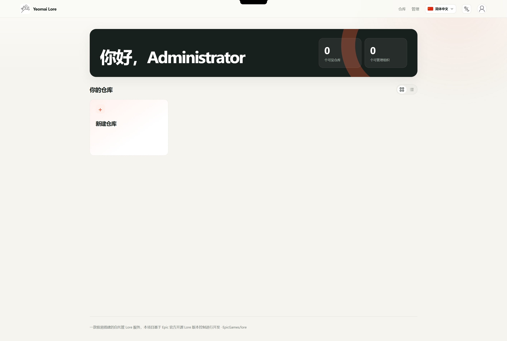
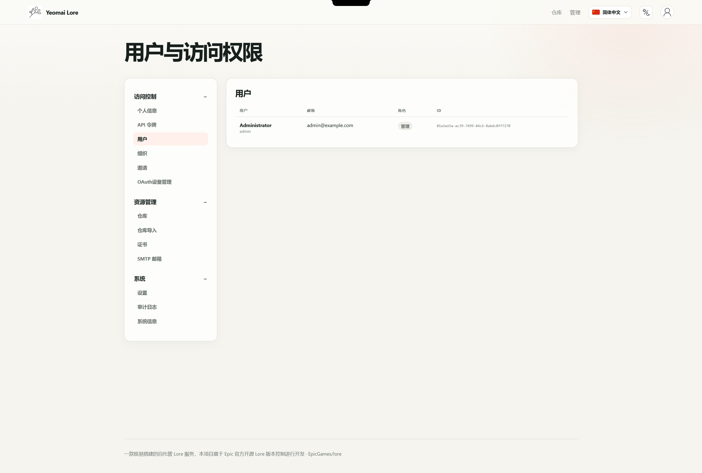
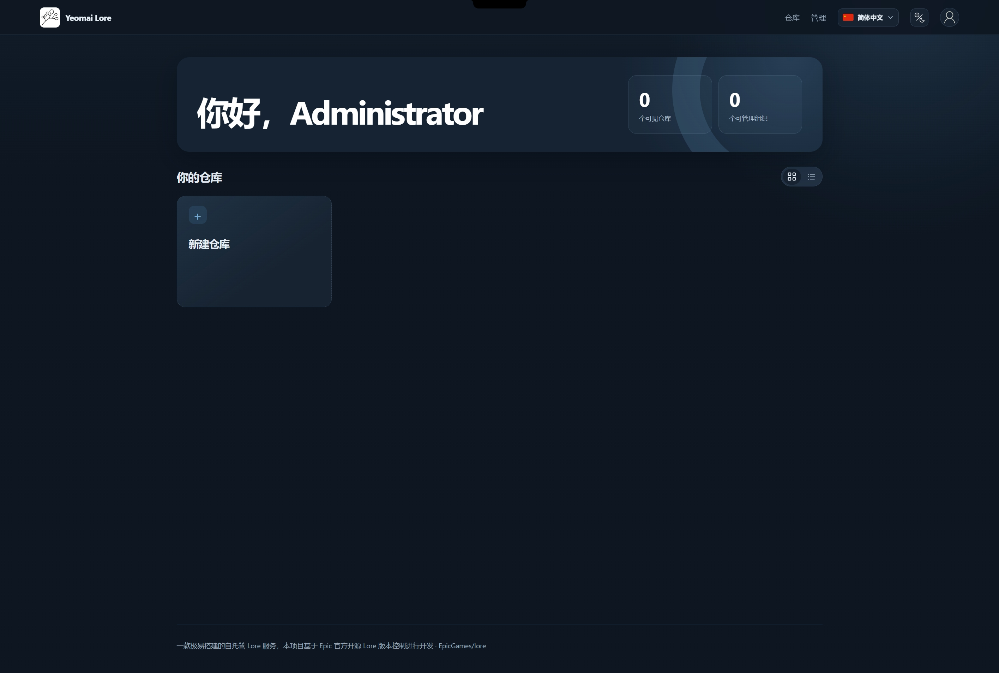
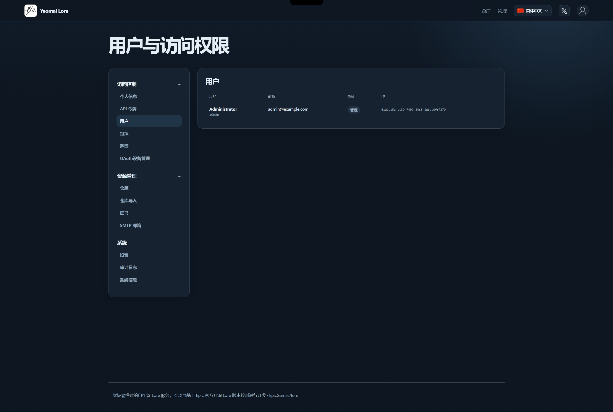

# Yeomai Lore

<p align="center">
  <a href="./README.md">English</a> |
  <a href="./README.zh-CN.md">简体中文</a>
</p>

<p align="center">
  
</p>
<p align="center">
  
</p>
<p align="center">
  
</p>
<p align="center">
  
</p>
<p align="center">
  
</p>
<p align="center">
  Project Demo：<a href="https://lore.yelove.yeomai.site">https://lore.yelove.yeomai.site</a>
</p>

<p align="center">
  Docker Hub：<a href="https://hub.docker.com/repository/docker/yeomaiyelove/yeomai-lore-web">https://hub.docker.com/repository/docker/yeomaiyelove/yeomai-lore-web</a>
</p>

<p align="center">
  Update Log：<a href="https://my.feishu.cn/wiki/UR1Pw2wJyilbg3krQFjceJZEnyi">https://my.feishu.cn/wiki/UR1Pw2wJyilbg3krQFjceJZEnyi</a>
</p>

- The demo site may be adjusted or cleaned up at any time and is intended for testing only.


- To use the prebuilt image, search for `yeomaiyelove/yeomai-lore-web` on Docker Hub.


A self-hosted web control plane for [Epic Games Lore](https://github.com/EpicGames/lore). The prototype provides built-in accounts, organization/repository ACLs, Lore Tier 2 authorization, repository creation, branch/revision history, file browsing, downloads, text diffs, invitations, API tokens, and audit records.

This is not a Gitea-compatible implementation. It does not expose Git or SSH remotes, Git Actions, pull requests, issues, or wiki pages yet. The current milestone is the phase 0–2 vertical slice described in [docs/IMPLEMENTATION.md](docs/IMPLEMENTATION.md).

See [docs/README.md](docs/README.md) for the complete documentation index.

## Architecture

```text
Browser / Lore Desktop / Lore CLI
                  |
                  v
       Unified entry 3000/TCP + 3000/UDP
           |                    |
           | HTTP               | Lore gRPC / QUIC
           v                    v
Next.js Web 41340/TCP   Lore Server 41337/TCP+UDP
           |
           v
Fastify API 4000/TCP
```

SQLite owns identities, organization membership, repository grants, invites, API tokens, and audit events. Lore owns repository identifiers, branches, revisions, trees, content, and locks. The default database is the single file `data/local/portal.sqlite` with WAL enabled.

The browser never receives Lore storage credentials. The API exchanges the user's login session for a repository-scoped JWT with the exact actions derived from SQLite ACL state.

The web interface supports English and Simplified Chinese. It follows the browser's `Accept-Language` on first visit, stores an explicit choice in the `locale` cookie, and keeps every language in `apps/web/src/i18n/messages.ts`. Adding another language means adding one dictionary and its locale tag; page components do not need translation-specific copies.

## Run locally

Prerequisites:

- Windows, macOS, or Linux with Node.js 22+, pnpm, Git, and OpenSSL.
- Windows users need Git for Windows because the development scripts use Git Bash.
- Ports `3000` TCP/UDP, `41340`, `4000`, `50051`, `41337` TCP/UDP, and `41339` available.

### Port exposure standard

The supported deployment model allows external Lore Desktop and Lore CLI
clients to connect to the server. Under this model, expose only the following
ports outside the host or private deployment network:

| Port | Protocol | Purpose |
| --- | --- | --- |
| `3000` | TCP + UDP | Unified HTTP, Lore gRPC, and QUIC endpoint |

Browsers use `http://localhost:3000`; Lore Desktop and the CLI use
`lore://localhost:3000`. The TCP listener selects Web or Lore gRPC by protocol,
and the UDP listener forwards QUIC to Lore.

The remaining ports are internal implementation details:

| Port | Protocol | Caller |
| --- | --- | --- |
| `41340` | TCP | Unified entry to Next.js Web; internal only |
| `4000` | TCP | Next.js proxy and Lore JWK/API access |
| `41337` | TCP + UDP | Unified entry to Lore gRPC and QUIC; internal only |
| `41339` | TCP | Backend access to Lore content |
| `50051` | TCP | Lore Server repository-registry gRPC |

Do not publish `4000`, `41337`, `41339`, `41340`, or `50051` directly. In a
container deployment, they must be reachable only on the private container
network. Block them at the host firewall in native local development. Port
`3000` must expose TCP and UDP because TCP carries HTTP/gRPC and UDP carries
Lore QUIC.

The image metadata also declares only `3000/TCP` and `3000/UDP`. Docker and
Portainer should create only these host mappings; all internal service ports
remain private.

If TLS is terminated by a reverse proxy, map both `443/TCP` and `443/UDP` to
the unified listener on `3000`. Public HTTPS and `lores://` can share one
hostname.

```bash
corepack enable
pnpm install
pnpm dev:local
```

Open <http://localhost:3000>.

On Windows, double-click `start.bat` to start the project and `stop.bat` to
stop it. The scripts check existing project processes, release and reserve the
required TCP/UDP ports, and verify all health endpoints.

`pnpm dev:local` creates the SQLite schema automatically, downloads the pinned official Lore Server and CLI into `data/local/bin`, generates internal TLS certificates, and runs all application processes natively. No PostgreSQL, Redis, or Docker daemon is involved.

The first visit opens a setup page. It asks for the first administrator
credentials, one unified site address, and the initial registration policy.
For example, `localhost:3000` derives `http://localhost:3000` and
`lore://localhost:3000`; a public domain derives matching `https://` and
`lores://` addresses. The administrator is created only after the form is
submitted and is not added to an organization. No organization is created
automatically.

The default addresses are `http://localhost:3000` for Web management and
`lore://localhost:3000` for Lore clients. Both protocols share one hostname and
port. Production `lores://` addresses require a matching certificate and private
key. Logs are under `data/local/logs/`.

The project pins Lore `0.14.0`. Its wrapper downloads release binaries rather than committing platform-specific executables:

```bash
./scripts/lore --version
./scripts/loreserver --version
```

`pnpm dev:local` checks both installed binaries against `LORE_VERSION` and automatically downloads the pinned release when either version is missing or stale. Docker deployments synchronize the persisted `/data/config/.env` `LORE_VERSION` value from the image on every container start.

## Build a first repository

Use the project-provided CLI:

```bash
./scripts/lore auth login lore://localhost:3000
```

Open the emitted device URL, sign in, and approve the request. Then create a repository in the web UI and push a first revision:

If a CLI workflow needs to resolve other users through the internal gRPC directory, trust the generated development CA for that process:

```bash
export SSL_CERT_FILE="$PWD/data/dev-certs/ca.crt"
```

```bash
./scripts/lore clone lore://localhost:3000/default/my-project
cd my-project
printf 'hello\n' > README.md
../scripts/lore stage README.md
../scripts/lore commit "Initial revision"
../scripts/lore push
```

The portal will then show the branch, revision history, file tree, downloadable blob, and text diff.

### OAuth identity behavior

- One OAuth identity session belongs to one user on one authenticated device. Its Refresh Token is shared by every repository that user can access from that device.
- Every Device Flow requires an explicit browser approval. The server never infers device identity from IP address or User-Agent.
- A new OAuth identity session starts with a 90-day Refresh Token. Access Token renewal uses that Refresh Token and does not start another Device Flow.
- Ordinary Access Token refreshes rotate the Refresh Token without restoring its full lifetime. A session can never be extended beyond three calendar years after it first started.
- A new device, a revoked OAuth identity, or an ambiguous device identity requires approval.
- The device approval status endpoint is read-only and does not require a portal login. Reopening the same approval URL only displays the existing result and never starts another approval.
- If the device flow is still pending, an unauthenticated browser is asked to sign in before the approve or deny controls are shown. Approve and deny remain protected by the portal session.
- After approval, the page does not redirect. It displays `Approval confirmed. Please close this page.` and attempts to close the browser page after one second. If the browser blocks closing, the result remains visible.
- Clearing local Lore credentials does not revoke the server-side OAuth session. Before switching users on the same computer, revoke the active OAuth identity in the web UI and then run the documented Lore logout command.

### Empty repository initialization

- When a repository is created through the portal or its API without an ignore template, the server creates one metadata-only initial revision before returning. The revision records `initialized=true`, while the repository content tree remains empty.
- When a repository is created directly by Lore Desktop, the portal only registers it. The server intentionally does not add an initial revision or trigger an extra Sync. Desktop remains responsible for creating the first revision.
- Older Lore Desktop clients such as `0.13.0` could show `No remote configured` when Sync was used before an empty Desktop-created repository had any revision. This is a client-side defect and is intentionally not worked around for Desktop-created repositories.

## Import an existing Git repository

Every signed-in user can use **管理 → 仓库导入**. A regular user's target is
always their personal namespace; administrators may also choose an
organization they can manage. The form accepts user-entered `http://`,
`https://`, or `git://` clone URLs. Private HTTP(S) repositories support an
access token only. Local paths, SSH URLs, and private-key
credentials are not accepted.

GitHub.com and self-hosted Gitea are detected automatically. When an access
token is supplied, the provider API validates it and resolves the Git username.
Git tags are an optional import choice. Wiki, issues, pull requests, releases,
and milestones are not imported in this version.

All users and administrators share one import queue. Exactly one import runs
at a time, and waiting jobs are scheduled in server request arrival order.
Each regular user can have at most one queued or running import at a time;
administrators have no queue-count limit. Regular users can only view and
manage their own jobs; administrators can view and manage all jobs.
A failed or cancelled import removes the incomplete target repository but
keeps its job log and warning report. Terminal import records can be cleaned
from the job list; successful imports keep their repository while their task
metadata and logs are removed.
Branches, two-parent merges, author metadata, Git SHA mappings, and tags are
preserved. LFS pointers are stored as ordinary files, submodules are skipped, and
octopus merges are imported on a best-effort basis with warnings.

### Current official import approach

The importer materializes the complete workspace only for the first commit.
Subsequent commits update and stage only paths reported by the Git diff instead
of extracting and scanning the complete tree for every revision.

This is the current official approach. It preserves complete Git history while
maintaining lower coupling to the Lore CLI, workspace behavior, and Lore version
boundaries.

### Future exploration after Lore's official release

The following approach will be explored after Lore reaches an official release:

The fastest long-term method is to bypass both the Git working tree and Lore CLI
disk operations by directly:

- Reading Git tree/blob objects.
- Writing file contents into Lore storage.
- Constructing Lore revision state, parent revisions, and metadata directly.
- Submitting the state through the Lore API.

This removes file materialization entirely, but requires deep integration with
Lore's internal revision-tree API. It has the largest implementation scope and
is the most vulnerable to changes in Lore versions.

See [docs/GIT_IMPORT.md](docs/GIT_IMPORT.md) for configuration, guarantees, and
current best-effort limitations.

On macOS the paths can be replaced by a shell alias:

```bash
alias lore="$PWD/scripts/lore"
```

## Development

```bash
corepack enable
pnpm install
pnpm typecheck
pnpm test
pnpm --filter @lore-portal/web build
```

Use `Ctrl-C` in the terminal running `pnpm dev:local` to stop the application processes.

On Windows, use `stop.bat` instead.

## Docker

After preparing `.env`, build and start the single-node deployment with Compose:

```bash
docker compose build
docker compose up -d
```

Portal Web, API, and Lore Server are packaged in one `yeomai-lore-web` image. The Lore Server binary is extracted directly from the official `ghcr.io/epicgames/lore/loreserver:0.14.0` image during the build. SQLite is intended for the single-node portal; a future multi-node deployment should use a network database instead.

The application version and bundled Lore version are declared in
`apps/web/version.json`. Release synchronization is documented in
[docs/RELEASING.md](docs/RELEASING.md). The image contains
`/usr/local/share/yeomai-lore/NOTICE`, and the entrypoint prints the version
banner plus the full third-party license and trademark notice at startup.

The Portal API is bundled into `apps/server/dist/index.js` at image build time and runs with `node dist/index.js`. The final runtime image does not include `tsx`, esbuild, TypeScript, Vitest, or other development-only packages.

Packaging and runtime constraints are documented in [docs/DOCKER_BUILD_SPEC.md](docs/DOCKER_BUILD_SPEC.md).

All persistent data is bind-mounted into the repository's `docker-data/`
directory instead of hidden Docker named volumes:

```text
docker-data/
  site/         SQLite, signing key, imports; mounted at /data
  site/lore/    Lore repositories, branches, revisions, and files
  site/config/.env           Portal runtime environment
  site/config/local.toml    Lore server authentication and public URL configuration
  certs/        Internal gRPC and Lore QUIC certificates
```

The directories are created in the repository. A complete backup can copy all
of `docker-data/`, and the files must be restored before starting the
deployment. Run Compose from the repository root so these relative paths do
not resolve somewhere else.

### Minimum safe backup

To retain existing repositories, users, authorization, and site configuration
after redeployment, back up at least:

```text
docker-data/site/lore/store/
docker-data/site/portal.sqlite
docker-data/site/keys/oidc-private.pem
docker-data/site/config/.env
```

- `site/lore/store/` contains Lore commits, branches, file trees, and file content.
- `site/portal.sqlite` contains users, organizations, repository ID/name mappings, permissions, site settings, OAuth state, and import records.
- `site/keys/oidc-private.pem` signs OIDC/JWT tokens and is also the source of the AES key used for portal secrets. Replacing it invalidates old JWTs and makes existing SMTP-password and invitation-link ciphertext undecryptable.
- `site/config/.env` contains public URLs, certificate paths, and process-level runtime configuration.

If redeployment generates or uploads a new certificate that matches the public
Lore domain, `docker-data/certs/` does not need to be backed up. This directory
contains the Lore QUIC/gRPC certificates and is separate from the Web site's
ordinary HTTPS certificate. After deployment, verify that `lore.crt` covers the
actual Lore service hostname; otherwise Lore clients will fail certificate
validation.

`site/config/local.toml` is regenerated at startup. `site/imports/` and
`site/run/` are also excluded from the minimum backup.

Stop the `app` service before backing up SQLite so WAL contents are merged and
recent changes are not omitted from a main-database-only copy.

To run the image without Compose, use the explicit volume wrapper:

```bash
pnpm run run:docker
```

It always applies these `-v` mappings and initializes the certificates before
starting the container:

```text
./docker-data/site   -> /data
./docker-data/certs  -> /certs
```

`/data/lore` is a child of `/data` and must not be mounted separately.

The first start creates `docker-data/site/config/.env`. Site addresses and the
first administrator are entered on the setup page. The API generates
`local.toml` from those persisted settings on every start, so custom addresses
and Lore certificates take effect after restarting the container.

When upgrading an installation whose SQLite settings contain different Web and
Lore hosts, the API preserves the legacy Lore host and migrates both addresses
to that host and the Web port during startup. This updates only
`system_settings`; users, repositories, permissions, and Lore storage are
untouched. `config/.env` is bootstrap configuration for new installations,
while SQLite remains authoritative for an existing site. The OIDC issuer
changes, so clients must sign in again after the migration.
The migration also revokes browser sessions and OAuth refresh tokens and
increments each user's `oauth_epoch` so credentials for the old host are no
longer accepted.

The `.env` file is authoritative for process-level runtime configuration. For
an initialized site, public addresses remain authoritative in SQLite. Do not
duplicate these variables in the Docker UI.

The image cannot infer host directories by itself. Use this wrapper or provide
equivalent `docker run -v` arguments.

## Current boundaries

- Lore is pre-1.0. Pin `0.14.0`; upgrade only after running the protocol and authentication regression suites.
- The native local profile is single-node and uses local Lore storage. It is not highly available.
- SMTP is configured under Administration → SMTP email. Its password is encrypted in SQLite. Without SMTP, invite and password-reset links are written to API logs for local testing.
- `ThinClient.ContentDiff` is not implemented in the pinned server. Portal computes bounded text diffs from Lore blobs in the API; binary and files larger than 2 MiB do not receive text rendering.
- Git import is an initial single-node implementation; resumable imports, private Git credentials, continuous Git synchronization, online editing, change requests, issues, wiki, releases, search, projects, package registry, webhooks, TOTP, and full production hardening remain subsequent phases.
- Local internal gRPC and Lore QUIC share persistent development certificates.
  `lore://` skips server-certificate verification. Production must use a
  domain certificate, install its CA, and switch to `lores://`.

## Validation

The implementation has been checked with:

- `pnpm typecheck`
- `pnpm test`
- `pnpm test:gateway`
- `pnpm --filter @lore-portal/web build`
- Official Lore CLI `0.14.0` device login, repository clone, stage, commit, and push
- Portal branch, revision, tree, blob, and text-diff queries against Lore `0.14.0`
- Cross-user ACL check: no access before a grant, read-only repository visibility after a grant

See [docs/IMPLEMENTATION.md](docs/IMPLEMENTATION.md) for the phased plan and remaining work.

## License

This project is released under the [MIT License](LICENSE).

The protocol files under `apps/server/proto` are derived from
[EpicGames/lore](https://github.com/EpicGames/lore) and retain their original
MIT copyright notice. See [NOTICE](NOTICE) for details.
